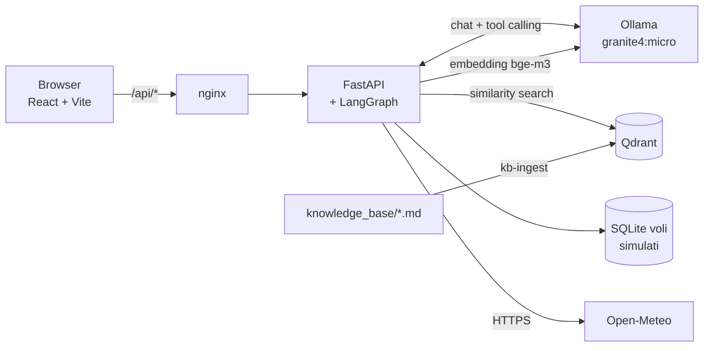
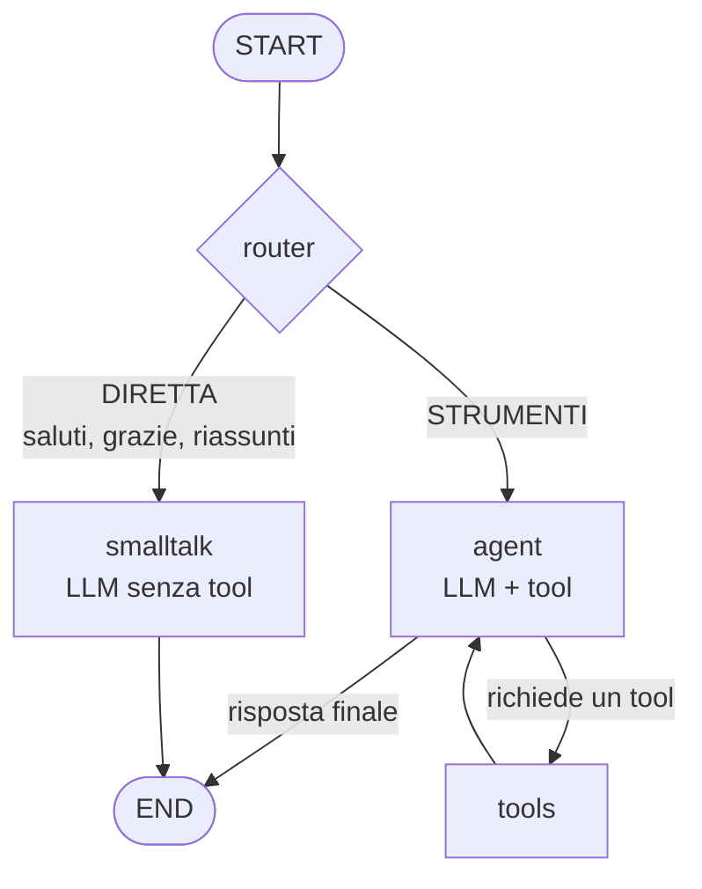

# ✈️ Travel Planning Agent

Assistente di viaggio conversazionale che gira **interamente in locale**: un agente [LangGraph](https://langchain-ai.github.io/langgraph/) basato su un LLM open-source servito da [Ollama](https://ollama.com) (modello configurabile in .env), che combina **RAG** su una knowledge base di viaggio, **meteo reale** e **ricerca voli** (simulata su db locale) tramite *tool calling*.

Niente API a pagamento, niente chiavi: l'intero stack parte con un solo comando Docker.

```bash
docker compose up -d --build
```

Poi apri **http://localhost:5173**.

---

## Cosa sa fare

| Capacità | Come funziona |
|---|---|
| 🗺️ **Guide e itinerari** | RAG su guide di 5 destinazioni (Roma, Parigi, Lisbona, Amsterdam, Barcellona): quartieri, attrazioni con orari e giorni di chiusura, cucina, trasporti, consigli pratici |
| 📋 **Policy e normative** | Policy dell'agenzia (prenotazioni, cancellazioni, rimborsi, assicurazione) distinta dalle regole reali su voli e diritti dei passeggeri (Reg. UE 261/2004, bagagli low cost, pacchetti turistici) |
| 👥 **Profili di viaggio** | Consigli su misura per coppia, famiglia con bambini, low cost, viaggiatore solo, senior/mobilità ridotta, appassionati di arte e storia |
| 🌦️ **Meteo reale** | Condizioni attuali e previsioni fino a 15 giorni via [Open-Meteo](https://open-meteo.com) (gratuito, senza API key) |
| 🛫 **Ricerca voli** | Voli diretti tra le 5 città con orari, compagnia, durata, prezzo e posti disponibili (database **simulato**, vedi [sotto](#database-voli-simulato)) |
| 💬 **Memoria** | Il contesto della conversazione è mantenuto per sessione; la chat viene ripristinata al refresh |
| 📎 **Trasparenza** | Ogni risposta mostra gli strumenti usati e le fonti consultate |

Esempi di domande:

- *"Pianificami 3 giorni a Roma per una coppia"*
- *"Che tempo farà a Lisbona la prossima settimana?"*
- *"Cerca voli Roma–Barcellona domani"*
- *"Il mio volo ha 4 ore di ritardo, ho diritto a un risarcimento?"*
- *"Cosa prevede la vostra policy di cancellazione?"*

---

## Avvio rapido

### Requisiti

- [Docker](https://docs.docker.com/get-docker/)
- Connessione a internet (al primo avvio per scaricare immagini e modelli; poi solo per il meteo)
- Alcuni GB di spazio libero per immagini Docker e modelli
- **GPU NVIDIA + [NVIDIA Container Toolkit](https://docs.nvidia.com/datacenter/cloud-native/container-toolkit/latest/install-guide.html)** (configurazione di default, vedi sotto se non l'hai)

### Avvio

```bash
git clone https://github.com/Francesco-Campagna/Agentic-AI-for-Travel-Planning
cd "Travel Planning Agent"      # la cartella radice, quella con docker-compose.yml

docker compose up -d --build
```

Al **primo avvio** Docker scarica le immagini e Ollama scarica i due modelli (default: `granite4:micro` e `bge-m3`): richiede qualche minuto.

Quando tutti i servizi sono pronti, apri **http://localhost:5173**. Gli avvii successivi sono molto più rapidi: modelli e indice vettoriale sono salvati in volumi Docker.

Per fermare tutto: `Ctrl+C` (oppure `docker compose stop`). Per cancellare anche i dati persistenti (modelli, indice, voli): `docker compose down -v`.

### ⚠️ Senza GPU NVIDIA (CPU-only, macOS, ecc.)

Il servizio `ollama` in `docker-compose.yml` riserva di default una GPU NVIDIA. Se non ne hai una, `docker compose up` fallirà con un errore tipo `could not select device driver "nvidia"`. In quel caso **elimina (o commenta) il blocco `deploy`** del servizio `ollama`:

```yaml
    # deploy:
    #   resources:
    #     reservations:
    #       devices:
    #         - driver: nvidia
    #           count: all
    #           capabilities: [gpu]
```

Tutto funziona comunque sulla CPU, solo con risposte più lente.


## Architettura



### Il grafo dell'agente



- **`router`** – una chiamata breve all'LLM (senza tool) classifica l'ultimo messaggio come `STRUMENTI` o `DIRETTA`. È *fail-safe*: nel dubbio, o in caso di errore, si passa dagli strumenti. Evita che un modello piccolo vada a cercare in knowledge base per un semplice "grazie".
- **`agent`** – LLM con i tool collegati; decide quali chiamare e poi formula la risposta. Il system prompt include la data di oggi, così "domani" o "venerdì" diventano date esatte. La cronologia dei turni passati viene compattata (risultati dei tool troncati) per restare nel contesto da 8192 token.
- **`tools`** – esegue i tool richiesti (`ToolNode`), poi si torna ad `agent`.
- **`smalltalk`** – risponde in modo cordiale senza accesso a strumenti.
- **Memoria**: `MemorySaver` di LangGraph in RAM, con `thread_id = session_id` (generato dal frontend per ogni scheda del browser). Si azzera al riavvio del backend.
- **Guard-rail**: limite di 8 passaggi nel grafo per evitare loop di tool call con modelli piccoli.

### I tool

| Tool | Cosa fa |
|---|---|
| `cerca_conoscenza` | Ricerca semantica nella knowledge base filtrata per città. Restituisce al modello i passaggi trovati e all'interfaccia le fonti strutturate |
| `meteo_citta` | Geocoding + previsioni da Open-Meteo (oggi, tra N giorni, fino a 7 giorni consecutivi mostrati) |
| `cerca_voli` | Interroga il database voli per tratta e data |

### Pipeline RAG

1. **Ingestion** (`app/rag/ingest.py`): legge i `.md` della knowledge base, ne estrae il frontmatter YAML (`doc_type`, `destination`…), divide per intestazioni (`#` → titolo, `##` → sezione) e poi per dimensione (chunk da 200 caratteri, overlap 100). La sezione "Attrazioni e musei" è divisa per singola voce di elenco. Le sezioni che sono istruzioni per il modello (non conoscenza) vengono escluse.
2. **Embedding**: `bge-m3` via Ollama, indicizzato in Qdrant con distanza coseno. Ogni chunk è prefissato con "Titolo — Sezione" per distinguere, ad esempio, i "Quartieri" di Roma da quelli di Parigi.
3. **Idempotenza**: viene calcolato un hash dei chunk e del modello di embedding; se l'indice è già aggiornato l'ingestion termina subito.
4. **Retrieval**: top-4 per similarità, filtro opzionale per destinazione, e scarto dei risultati con punteggio troppo distante dal migliore (`RAG_SCORE_MARGIN`).

### Database voli (simulato)

I voli **non sono reali**: sono generati in modo deterministico (`app/flights/seed.py`) in un database SQLite, a scopo dimostrativo.

- 5 città / aeroporti: Roma (FCO), Parigi (CDG), Lisbona (LIS), Amsterdam (AMS), Barcellona (BCN)
- 20 tratte (10 coppie × 2 direzioni), 3 voli al giorno per tratta con orari e numeri di volo fissi
- Prezzi e posti variano per giorno (più cari nel weekend e a ridosso della partenza)
- Copertura di 60 giorni a partire da oggi; il database viene creato all'avvio del backend e rigenerato automaticamente quando restano meno di 14 giorni di voli
- Gli orari sono locali (Lisbona è un'ora indietro rispetto alle altre città)

---

## API

| Metodo | Endpoint | Descrizione |
|---|---|---|
| `POST` | `/api/chat` | `{ "session_id": "...", "message": "..." }` → `{ "answer", "sources": [{title, source}], "tools": [...] }` |
| `GET` | `/api/history/{session_id}` | Cronologia della sessione (usata dal frontend per ripristinare la chat) |
| `GET` | `/api/health` | Stato del backend e raggiungibilità di Ollama |

```bash
curl -X POST http://localhost:8000/api/chat \
  -H "Content-Type: application/json" \
  -d '{"session_id": "demo", "message": "Cosa vedere a Lisbona in due giorni?"}'
```

---

## Configurazione

Il file `.env` nella radice viene letto da Docker Compose. Tutte le variabili sono opzionali (i default sono nel `docker-compose.yml`).

| Variabile | Default | Descrizione |
|---|---|---|
| `OLLAMA_MODEL` | `granite4:micro` | Modello LLM per chat e tool calling |
| `OLLAMA_EMBED_MODEL` | `bge-m3` | Modello di embedding per la RAG |
| `OLLAMA_TEMPERATURE` | `0.1` | Temperatura di generazione |
| `OLLAMA_KEEP_ALIVE` | `30m` | Per quanto il modello resta in memoria |
| `OLLAMA_CONTEXT_LENGTH` | `8192` | Finestra di contesto |

Per cambiare modello basta modificare `OLLAMA_MODEL`  e rilanciare `docker compose up -d --build`: `model-init` scarica quello nuovo. Se cambi `OLLAMA_EMBED_MODEL` l'indice viene ricostruito automaticamente.

Altre impostazioni (top-k della RAG, timeout meteo, giorni di voli generati, CORS…) sono in `backend/app/config.py`.

---

## Struttura del progetto

```
.
├── docker-compose.yml
├── .env                         # configurazione modelli (letta da Compose)
├── knowledge_base/              # documenti Markdown indicizzati nella RAG
│   ├── destinations/            #   guide: Roma, Parigi, Lisbona, Amsterdam, Barcellona
│   ├── policies/                #   policy agenzia + normativa e regole delle compagnie aeree
│   └── profiles/                #   profili di viaggio
├── backend/
│   ├── Dockerfile
│   ├── requirements.txt
│   └── app/
│       ├── main.py              # FastAPI: /api/chat, /api/history, /api/health
│       ├── config.py            # impostazioni (pydantic-settings)
│       ├── schemas.py           # modelli di richiesta/risposta
│       ├── agent/               # grafo LangGraph, router, prompt, tool, client meteo
│       ├── rag/                 # ingestion, retriever, store Qdrant, check di qualità
│       └── flights/             # schema SQLite, seed dei voli simulati, servizio di ricerca
└── frontend/
    ├── Dockerfile               # build Vite + nginx
    ├── nginx.conf               # serve la SPA e fa da proxy su /api
    └── src/                     # App React (chat, suggerimenti, fonti, ripristino cronologia)
```

### Aggiungere conoscenza

Aggiungi o modifica un file `.md` in `knowledge_base/` (con frontmatter `doc_type` e, per le guide, `destination`) e rilancia l'ingestion:

```bash
docker compose run --rm kb-ingest
```

---

## Stack tecnologico

**Backend** Python 3.11 · FastAPI · LangGraph · LangChain (Ollama, Qdrant) · Pydantic · SQLite · httpx
**AI** Ollama · IBM Granite 4 Micro (`granite4:micro`) · BGE-M3 · Qdrant
**Frontend** React 18 · Vite · react-markdown · nginx
**Infrastruttura** Docker Compose

---

## Note

- I dati dell'agenzia ("policy dell'agenzia") sono **fittizi**, creati per scopi didattici.
- I voli sono **simulati**; il meteo è reale (Open-Meteo).
- Le informazioni nella knowledge base (orari, tariffe, regole) possono cambiare: verifica sempre le fonti ufficiali prima di viaggiare. L'agente non fornisce consulenza legale.
